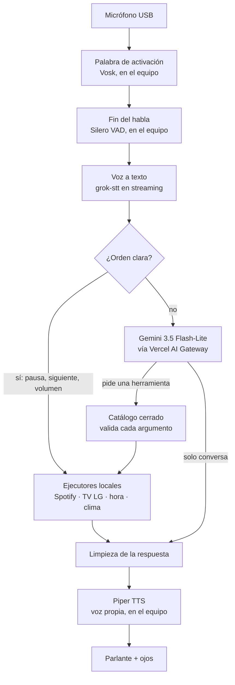

# VaderMind

**Un asistente de voz con la personalidad de Darth Vader, que vive dentro de un
casco real.** Corre en una Raspberry Pi 4 escondida en la cúpula, despierta
cuando le dices *"Oye Vader"*, responde con su propia voz sintética, pone
música en Spotify, controla la tele y sus ojos se encienden mientras escucha,
piensa y habla.

[Read in English](README.md)

> Pronto habrá fotos y un video de demostración.

> **Proyecto de fans.** VaderMind es un proyecto de fans no oficial y sin fines
> comerciales. No está afiliado a Lucasfilm Ltd. ni a The Walt Disney Company,
> ni cuenta con su respaldo o patrocinio. Darth Vader y Star Wars son marcas
> suyas. Este repositorio no contiene audio, modelos de voz ni otro material de
> las películas.

---

## Qué hace

- **Manos libres.** Di *"Oye Vader"* y habla. La palabra de activación se
  detecta en el equipo: ningún audio sale del casco antes de oírla. Después de
  cada respuesta sigue escuchando 10 segundos, así la conversación fluye sin
  repetir la palabra. *"Vader, silencio"* lo devuelve al reposo.
- **Dos personalidades.** *Canon*: el Vader clásico, frío y breve. *Chileno*:
  Vader después de vivir muchos años en Chile, relajado, talla y lleno de
  chilenismos. Se cambia por voz: *"modo chileno"*.
- **Spotify.** Reproducir, pausar, saltar, volumen, cola, biblioteca,
  búsquedas por tipo, playlists y "ponlo en la tele" (enciende el TV, abre
  Spotify ahí y mueve la música).
- **TV LG webOS** por la red local: encendido (Wake-on-LAN), volumen, apps,
  entradas HDMI, canales, pantalla, mensajes en pantalla y temporizadores. Cada
  cambio se confirma leyendo de vuelta el estado del TV.
- **Hora y clima** (Open-Meteo). Todo lo demás de la web está deshabilitado a
  propósito: ni búsquedas, ni noticias, ni precios, ni deportes.
- **Ojos vivos.** Dos anillos de 7 LEDs detrás de los lentes: "pupilas" tenues
  en reposo, escuchando, pensando (el anillo respira), hablando (el anillo
  sigue el volumen de la voz) y error.
- **Dos hogares, un casco.** Cada hogar tiene su perfil (cuenta de Spotify,
  TV, temporizadores, personalidad), elegido solo según la red Wi-Fi.
- **Enchufar y listo.** Conectas el power bank y Vader está listo en unos 36 s.

Vader habla español. Los prompts de personalidad también existen en inglés
(`VADER_LANGUAGE=en`), pero la palabra de activación, la transcripción y la voz
propia se construyeron y ajustaron para el español.

## Cómo viaja una frase



1. **Palabra de activación.** [Vosk](https://alphacephei.com/vosk/) escucha con
   una gramática cerrada: la frase, unas pocas frases chilenas parecidas que
   sirven de señuelo ("vas a ver", "oye") y "desconocido". Solo cuenta el
   resultado final, con una confianza mínima por palabra.
2. **Fin del habla.** [Silero VAD](https://github.com/snakers4/silero-vad)
   decide cuándo terminaste de hablar (800 ms de silencio).
3. **Transcripción.** El audio viaja a `grok-stt` mientras hablas, así el texto
   está listo apenas callas. Si el streaming falla, entra `gpt-4o-transcribe`
   con un contexto de chilenismos. Un texto en otro idioma se descarta.
4. **Reglas o modelo.** Las órdenes inequívocas (*"pausa"*, *"siguiente"*,
   *"sube el volumen de la tele"*) no pasan por el modelo. Todo lo demás va a
   Gemini 3.5 Flash-Lite; lo explícitamente complejo y los fallos van a
   Gemini 3.7 Flash. Ambos a través de
   [Vercel AI Gateway](https://vercel.com/ai-gateway).
5. **Catálogo cerrado.** El modelo solo puede pedir una intención de una lista
   fija. El código valida nombres, tipos, valores permitidos y largos antes de
   ejecutar nada.
6. **Voz.** [Piper](https://github.com/rhasspy/piper) habla con una voz propia,
   oración por oración: la primera suena mientras se sintetizan las
   siguientes. Los ojos siguen el volumen de cada oración.

Más detalle en [Cómo funciona](docs/es/como-funciona.md).

## Principios de diseño

- **El modelo nunca toca la red.** No puede enviar URLs, comandos al TV,
  códigos de botones ni solicitudes arbitrarias. Elige una intención; el código
  local decide si se ejecuta y cómo.
- **Decirlo, hacerlo y comprobarlo.** En modo voz, Vader anuncia una acción de
  Spotify antes de ejecutarla. Los cambios del TV (apps, entradas, pantalla,
  canales, encendido) se verifican leyendo el estado de vuelta y se reintentan
  una vez. Un paquete Wake-on-LAN nunca se informa como "TV encendido" hasta
  que webOS responde.
- **Privacidad por defecto.** La palabra de activación corre en el equipo; el
  micrófono está cerrado mientras Vader habla; cada solicitud al modelo le pide
  al gateway no usarla para entrenar; la conversación vive solo en memoria (los
  últimos 8 mensajes) y desaparece cuando Vader se detiene.
- **Rápido como para sentirse una persona.** Streaming en todas partes,
  transcripción especulativa, conexiones precalentadas, un proceso Piper
  persistente y síntesis oración por oración. Ver [Velocidad](docs/es/velocidad.md).
- **Fallos honestos.** Si algo falla, Vader lo dice en voz alta. Nunca finge que
  una acción funcionó.

## Números

Medidos en la Raspberry Pi 4 dentro del casco (noviembre de 2026). Medianas de
un guion fijo de 19 frases, tres rondas, antes del último trabajo de velocidad,
que quitó unos 0,45 s más por turno con voz.

| Desde que callas hasta el primer sonido de Vader | Mediana |
| --- | ---: |
| Charla ("¿Cómo estás?") | 3,95 s |
| Hora / clima | 3,30 s / 3,92 s |
| Spotify a través del modelo ("pon Metallica") | 3,45 s |
| Spotify por regla local ("siguiente canción") | 1,74 s |
| Volumen del TV por regla local | 1,66 s |

| Otros | Valor |
| --- | ---: |
| Arranque en frío, de enchufar a listo | 36 s |
| Error por palabra, micro detrás de la rejilla de la barbilla, 1 m / 2 m | 2,6 % / 0,9 % |
| Temperatura de la Pi en el casco tras 5 min de habla continua | 42 °C, sin bajar la velocidad |
| Datos de entrenamiento de la voz propia | 398 clips, 36 minutos |
| Pruebas automatizadas | 424 |

## Hardware

| Pieza | Notas |
| --- | --- |
| Raspberry Pi 4 Model B, 4 GB | Raspberry Pi OS Lite 64 bits (Debian 13), Python 3.13, ventilador en los pines 4, 6 y 8 |
| Micrófono USB | Solo graba a 44,1/48 kHz: Vader convierte a 16 kHz y filtra bajo 90 Hz |
| Parlantes | Audio por el jack de 3,5 mm; el USB solo los alimenta |
| 2 módulos WS2812 de 7 LEDs | Por SPI (pin 19, GPIO10), 330 Ω en datos, 1000 µF en la alimentación |
| Power bank | Por su salida USB-A. Una fuente de pared metía zumbido de 50 Hz al micro |

Cableado, lecciones de energía y cómo cabe todo en el casco:
[Hardware](docs/es/hardware.md).

## Estructura del repositorio

```text
main.py               punto de entrada (CLI)
vadermind/            el asistente
  orchestrator.py     un turno: reglas, modelo, herramientas, voz
  brain.py            niveles de modelo, prompt, llamadas a herramientas
  persona.py          las dos personalidades
  tools/              catálogo (validación), router (reglas locales) y ejecutores
  hands_free.py       bucle de "Oye Vader" y ventana de seguimiento
  wake_word.py        palabra de activación con Vosk
  listening.py        micrófono, fin del habla, transcripción especulativa
  stt_streaming.py    transcripción en streaming
  voice_output.py     Piper (más OpenAI y ElevenLabs como alternativas)
  lights.py           los ojos (WS2812 por SPI, consola o nada)
  profiles.py         un perfil por hogar, elegido por la Wi-Fi
tests/                424 pruebas automatizadas, sin red ni hardware
scripts/              benchmarks, informe de latencia, pruebas de LEDs, ayuda de perfiles
deploy/               servicio systemd para la Pi
cloud_training/       receta para afinar la voz Piper en una GPU arrendada
evaluations/          los escenarios con que se eligió el modelo conversacional
docs/                 cómo funciona, hardware, voz, velocidad, cómo se hizo
```

Los comentarios del código, los mensajes del log y las opciones de la línea de
comandos están en español (`--manos-libres`, `--perfil`).

## Probarlo

Necesitas Python 3.13 y una clave de
[Vercel AI Gateway](https://vercel.com/ai-gateway). Spotify, el TV, la
Raspberry Pi y los LEDs son opcionales.

```powershell
git clone https://github.com/Panchopipe/VaderMind.git
cd VaderMind
python -m venv .venv
.\.venv\Scripts\Activate.ps1      # en Linux: source .venv/bin/activate
pip install -r requirements.txt
copy .env.example .env            # en Linux: cp .env.example .env
```

Pon tu `AI_GATEWAY_API_KEY` en `.env` y luego:

| Comando | Qué obtienes |
| --- | --- |
| `python main.py` | Chat de texto en la terminal (`--mode chileno` para la otra personalidad) |
| `python main.py --voice` | Respuestas habladas (ver la nota de voz abajo) |
| `python main.py --voice --listen` | Hablarle: presionas Enter, hablas y detecta cuando terminas |
| `python main.py --manos-libres` | Manos libres completo con "Oye Vader" |
| `python main.py --spotify-auth` | Conectar una cuenta Spotify Premium |
| `python -m unittest discover -s tests` | Correr las pruebas |

**Voz.** La voz propia de Vader no viene incluida. Usa
`VADER_TTS_PROVIDER=openai` con una `OPENAI_API_KEY`, o descarga cualquier voz
Piper de [piper-voices](https://huggingface.co/rhasspy/piper-voices) y apunta
`PIPER_EXECUTABLE`, `PIPER_MODEL_PATH` y `PIPER_CONFIG_PATH` a ella.

**Escuchar** necesita el modelo Silero VAD, y manos libres el modelo Vosk en
español:

```bash
mkdir -p models/vad models/vosk
curl -sSL -o models/vad/silero_vad.onnx https://raw.githubusercontent.com/snakers4/silero-vad/v6.2.3/src/silero_vad/data/silero_vad.onnx
curl -sSL -o model.zip https://alphacephei.com/vosk/models/vosk-model-small-es-0.42.zip   # descomprimir en models/vosk/
```

**Spotify** necesita una app en el
[Spotify Developer Dashboard](https://developer.spotify.com/dashboard) con la
Redirect URI `http://127.0.0.1:8765/callback`, y su client ID y secret en
`.env`. **El TV LG** necesita `LG_TV_HOST`, `LG_TV_MAC` y
`LG_TV_BROADCAST_ADDRESS`, más el control por IP y Wake-on-LAN activados en el
TV; la primera conexión muestra una autorización en pantalla. **En la Pi**,
`deploy/vadermind.service` arranca Vader al encender (instrucciones dentro del
archivo). Cada opción está documentada en `.env.example`.

## Limitaciones conocidas

Una auditoría de solo lectura de todo el código, en noviembre de 2026, no
encontró nada crítico ni ningún secreto que haya entrado alguna vez a Git, pero
sí detalles por pulir. **Se corregirán pronto:**

- Un corte de red mientras habla con Spotify o con el modelo puede botar el
  programa; systemd lo levanta 15 a 20 segundos después, sin decir por qué.
- Si el arranque falla (por ejemplo, con el micrófono desconectado), systemd
  no vuelve a intentarlo.
- La confirmación hablada para apagar la Pi acepta algunas respuestas
  negativas, como *"claro que no"*.
- *"Pon la tele en HDMI 2"* y *"pon la tele en silencio"* muestran un mensaje
  en pantalla en vez de obedecer: una regla local coincide primero.
- En manos libres, las transcripciones y respuestas quedan en el registro del
  sistema.
- La ventana de seguimiento no tiene tope: una tele hablando al lado puede
  encadenar varios turnos.
- Los temporizadores atrasados del TV se ejecutan al siguiente inicio, sin
  importar su antigüedad.
- El archivo del token de Spotify se reescribe sin protección ante cortes de
  luz.
- Las dependencias no tienen versiones fijas.

Por diseño, no son errores: una herramienta por turno (*"prende la tele y abre
Netflix"* solo la enciende), YouTube se abre pero no busca, y el acceso
general a la web está deshabilitado.

## Cómo se hizo

VaderMind lo construyó una persona en menos de ocho meses (abril a noviembre de
2026), trabajando con agentes de programación con IA (OpenAI Codex y Claude
Code) y un método común e independiente del agente: un archivo corto de
reglas, un ledger de cada sesión de trabajo al que solo se le agregan entradas,
un plan consolidado y un documento de traspaso por fase. El ledger terminó con
95 entradas. La historia, el método y lo que funcionó:
[Cómo se hizo](docs/es/como-se-hizo.md).

## Créditos y licencias

El código de este repositorio se publica bajo la [licencia MIT](LICENSE).

VaderMind se apoya en estos proyectos, cada uno con su propia licencia:
[Piper](https://github.com/rhasspy/piper) (texto a voz),
[Vosk](https://alphacephei.com/vosk/) y su modelo `vosk-model-small-es-0.42`
(palabra de activación, Apache 2.0),
[Silero VAD](https://github.com/snakers4/silero-vad) (fin del habla, MIT),
[aiowebostv](https://github.com/home-assistant-libs/aiowebostv) (LG webOS),
[ONNX Runtime](https://onnxruntime.ai/), [httpx](https://www.python-httpx.org/),
[aiohttp](https://docs.aiohttp.org/), [NumPy](https://numpy.org/) y
[python-sounddevice](https://python-sounddevice.readthedocs.io/).
Datos del clima de [Open-Meteo.com](https://open-meteo.com/) (CC BY 4.0).
La voz propia se afinó desde el checkpoint público de Piper `es_MX-ald-medium`
([rhasspy/piper-checkpoints](https://huggingface.co/datasets/rhasspy/piper-checkpoints)),
que no se redistribuye aquí.
