# VaderMind

**A voice assistant with Darth Vader's personality, living inside a real helmet.**
It runs on a Raspberry Pi 4 hidden in the dome, wakes up when you say
*"Oye Vader"* ("Hey Vader" in Spanish), answers with its own synthetic voice,
plays music on Spotify, controls the TV, and its eyes light up while it
listens, thinks and speaks.

[Leer en español](README.es.md)

> Photos and a demo video are coming soon.

> **Fan project.** VaderMind is an unofficial, non-commercial fan project. It is
> not affiliated with, endorsed or sponsored by Lucasfilm Ltd. or The Walt
> Disney Company. Darth Vader and Star Wars are their trademarks. This
> repository contains no audio, voice model or other material from the films.

---

## What it does

- **Hands-free.** Say *"Oye Vader"* and talk. The wake word is detected on the
  device: no audio leaves the helmet before it hears it. After each answer it
  keeps listening for 10 seconds, so a conversation flows without repeating
  the wake word. *"Vader, silencio"* sends it back to sleep.
- **Two personalities.** *Canon*: the classic, cold, brief Vader. *Chileno*:
  Vader after many years living in Chile, relaxed and funny, full of Chilean
  slang. Switch by voice: *"modo chileno"*.
- **Spotify.** Play, pause, skip, volume, queue, library, typed searches,
  playlists, and "play it on the TV" (turns the TV on, opens Spotify there and
  moves the music).
- **LG webOS TV**, over the local network: power (Wake-on-LAN), volume, apps,
  HDMI inputs, channels, screen on/off, on-screen messages and timers. Every
  change is confirmed by reading the TV state back.
- **Time and weather** (Open-Meteo). Everything else from the web is
  deliberately disabled: no search, news, prices or sports.
- **Living eyes.** Two rings of 7 LEDs behind the lenses: dim "pupils" when
  idle, listening, thinking (the ring breathes), speaking (the ring follows the
  volume of the voice) and error.
- **Two homes, one helmet.** Each home has its own profile (Spotify account,
  TV, timers, personality), picked automatically from the Wi-Fi network.
- **Plug and play.** Connect the power bank and Vader is ready in about 36 s.

Vader speaks Spanish. The personality prompts also exist in English
(`VADER_LANGUAGE=en`), but the wake word, speech recognition and custom voice
were built and tuned for Spanish.

## How a sentence travels

```mermaid
flowchart LR
    MIC["USB mic"] --> WAKE["Wake word<br/>Vosk, on device"]
    WAKE --> VAD["End of speech<br/>Silero VAD, on device"]
    VAD --> STT["Speech to text<br/>grok-stt streaming"]
    STT --> RULES{"Clear order?"}
    RULES -- "yes: pause, next, volume" --> EXEC
    RULES -- no --> LLM["Gemini 3.5 Flash-Lite<br/>via Vercel AI Gateway"]
    LLM -- "asks for a tool" --> CAT["Closed tool catalog<br/>validates every argument"]
    CAT --> EXEC["Local executors<br/>Spotify · LG TV · time · weather"]
    LLM -- "just talks" --> TEXT["Reply cleanup"]
    EXEC --> TEXT
    TEXT --> TTS["Piper TTS<br/>custom voice, on device"]
    TTS --> OUT["Speaker + eyes"]
```



1. **Wake word.** [Vosk](https://alphacephei.com/vosk/) listens with a closed
   grammar: the phrase, a few similar Chilean decoys ("vas a ver", "oye") and
   "unknown". Only the final result counts, with a minimum confidence per word.
2. **End of speech.** [Silero VAD](https://github.com/snakers4/silero-vad)
   decides when you stopped talking (800 ms of silence).
3. **Transcription.** The audio streams to `grok-stt` while you speak, so the
   text is ready the moment you stop. If streaming fails, it falls back to
   `gpt-4o-transcribe` with a Chilean-slang context. Text in another language
   is discarded.
4. **Rules or model.** Unambiguous orders (*"pausa"*, *"siguiente"*,
   *"sube el volumen de la tele"*) skip the model. Everything else goes to
   Gemini 3.5 Flash-Lite; explicitly complex requests and failures go to
   Gemini 3.7 Flash. Both through [Vercel AI Gateway](https://vercel.com/ai-gateway).
5. **Closed catalog.** The model can only ask for an intent from a fixed list.
   The code validates names, types, enums and lengths before anything runs.
6. **Voice.** [Piper](https://github.com/rhasspy/piper) speaks with a custom
   voice, sentence by sentence: the first sentence plays while the next ones
   are synthesized. The eyes follow the volume of each sentence.

More detail in [How it works](docs/how-it-works.md).

## Design principles

- **The model never touches the network.** It cannot send URLs, TV commands,
  button codes or arbitrary requests. It picks an intent; local code decides
  whether and how to run it.
- **Say it, then do it, then check it.** In voice mode Vader announces a
  Spotify action before running it. TV changes (apps, inputs, screen,
  channels, power) are verified by reading the state back, and retried once.
  A Wake-on-LAN packet is never reported as "TV on" until webOS answers.
- **Privacy by default.** The wake word runs on the device; the microphone is
  closed while Vader speaks; every model request asks the gateway not to use
  it for training; the conversation lives only in memory (the last 8
  messages) and is gone when Vader stops.
- **Fast enough to feel like a person.** Streaming everywhere, speculative
  transcription, pre-warmed connections, a persistent Piper process and
  sentence-by-sentence synthesis. See [Performance](docs/performance.md).
- **Honest failures.** If something fails, Vader says so out loud. It never
  pretends an action worked.

## Numbers

Measured on the Raspberry Pi 4 inside the helmet (November 2026). Medians
from a fixed 19-phrase script, three rounds, before the last speed work,
which removed about 0.45 s more per voice turn.

| From you stop talking to Vader's first sound | Median |
| --- | ---: |
| Chat ("¿Cómo estás?") | 3.95 s |
| Time / weather | 3.30 s / 3.92 s |
| Spotify through the model ("pon Metallica") | 3.45 s |
| Spotify by local rule ("siguiente canción") | 1.74 s |
| TV volume by local rule | 1.66 s |

| Other | Value |
| --- | ---: |
| Cold boot, from plugging in to ready | 36 s |
| Word error rate, mic behind the chin grille, 1 m / 2 m | 2.6 % / 0.9 % |
| Pi temperature inside the helmet after 5 min of nonstop speech | 42 °C, no throttling |
| Custom voice training data | 398 clips, 36 minutes |
| Automated tests | 424 |

## Hardware

| Part | Notes |
| --- | --- |
| Raspberry Pi 4 Model B, 4 GB | Raspberry Pi OS Lite 64-bit (Debian 13), Python 3.13, fan on pins 4, 6 and 8 |
| USB microphone | Records only at 44.1/48 kHz: Vader resamples to 16 kHz and filters below 90 Hz |
| Speakers | Audio through the 3.5 mm jack; USB only powers them |
| 2 x WS2812 modules, 7 LEDs each | Driven over SPI (pin 19, GPIO10), 330 Ω on data, 1000 µF on power |
| Power bank | Through its USB-A output. A wall adapter put 50 Hz hum into the mic |

Wiring, power lessons and how everything fits in the helmet:
[Hardware](docs/hardware.md).

## Repository layout

```text
main.py               entry point (CLI)
vadermind/            the assistant
  orchestrator.py     one turn: rules, model, tools, voice
  brain.py            model tiers, prompt, tool calls
  persona.py          the two personalities
  tools/              catalog (validation), router (local rules) and executors
  hands_free.py       "Oye Vader" loop and follow-up window
  wake_word.py        Vosk wake word
  listening.py        microphone, end of speech, speculative transcription
  stt_streaming.py    streaming transcription
  voice_output.py     Piper (plus OpenAI and ElevenLabs as alternatives)
  lights.py           the eyes (WS2812 over SPI, console or none)
  profiles.py         one profile per home, picked by Wi-Fi
tests/                424 automated tests, no network or hardware needed
scripts/              benchmarks, latency report, LED tests, profile helper
deploy/               systemd service for the Pi
cloud_training/       recipe to fine-tune the Piper voice on a rented GPU
evaluations/          the scenarios used to choose the conversation model
docs/                 how it works, hardware, voice, performance, how it was built
```

Code comments, log messages and command-line flags are in Spanish
(`--manos-libres` means hands-free, `--perfil` means profile).

## Try it

You need Python 3.13 and a [Vercel AI Gateway](https://vercel.com/ai-gateway)
API key. Spotify, the TV, the Raspberry Pi and the LEDs are all optional.

```powershell
git clone https://github.com/Panchopipe/VaderMind.git
cd VaderMind
python -m venv .venv
.\.venv\Scripts\Activate.ps1      # on Linux: source .venv/bin/activate
pip install -r requirements.txt
copy .env.example .env            # on Linux: cp .env.example .env
```

Put your `AI_GATEWAY_API_KEY` in `.env`, then:

| Command | What you get |
| --- | --- |
| `python main.py` | Text chat in the terminal (`--mode chileno` for the other personality) |
| `python main.py --voice` | Spoken answers (see the voice note below) |
| `python main.py --voice --listen` | Talk to it: press Enter, speak, it detects when you stop |
| `python main.py --manos-libres` | Fully hands-free with "Oye Vader" |
| `python main.py --spotify-auth` | Connect a Spotify Premium account |
| `python -m unittest discover -s tests` | Run the test suite |

**Voice.** The custom Vader voice is not included. Either set
`VADER_TTS_PROVIDER=openai` with an `OPENAI_API_KEY`, or download any Piper
voice from [piper-voices](https://huggingface.co/rhasspy/piper-voices) and
point `PIPER_EXECUTABLE`, `PIPER_MODEL_PATH` and `PIPER_CONFIG_PATH` to it.

**Listening** needs the Silero VAD model, and hands-free needs the Vosk Spanish
model:

```bash
mkdir -p models/vad models/vosk
curl -sSL -o models/vad/silero_vad.onnx https://raw.githubusercontent.com/snakers4/silero-vad/v6.2.3/src/silero_vad/data/silero_vad.onnx
curl -sSL -o model.zip https://alphacephei.com/vosk/models/vosk-model-small-es-0.42.zip   # unzip into models/vosk/
```

**Spotify** needs an app in the
[Spotify Developer Dashboard](https://developer.spotify.com/dashboard) with the
redirect URI `http://127.0.0.1:8765/callback`, and its client ID and secret in
`.env`. **The LG TV** needs `LG_TV_HOST`, `LG_TV_MAC` and
`LG_TV_BROADCAST_ADDRESS`, plus IP control and Wake-on-LAN enabled on the TV;
the first connection shows a pairing prompt on screen. **On the Pi**,
`deploy/vadermind.service` starts Vader on boot (instructions inside the file).
Every setting is documented in `.env.example`.

## Known limitations

A read-only audit of the whole code base in November 2026 found no critical
issue and no secret ever committed, but it did find rough edges. **They will be
fixed soon:**

- A network drop while talking to Spotify or the model can crash the process;
  systemd brings it back 15 to 20 seconds later, without saying why.
- If startup fails (for example, the microphone is unplugged), systemd does
  not retry.
- The spoken confirmation to shut the Pi down accepts some negative answers,
  such as *"claro que no"*.
- *"Pon la tele en HDMI 2"* and *"pon la tele en silencio"* show an on-screen
  message instead of obeying: a local rule matches first.
- In hands-free mode, transcripts and replies end up in the system journal.
- The follow-up window has no cap: a TV talking nearby can chain several turns.
- Overdue TV timers run on the next start, no matter how old they are.
- The Spotify token file is rewritten without protection against power cuts.
- Dependencies are not pinned to exact versions.

By design, not bugs: one tool per turn (*"turn on the TV and open Netflix"*
only turns it on), YouTube opens but cannot search, and general web access is
disabled.

## How it was built

VaderMind was built by one person in under eight months (April to November 2026),
working with AI coding agents (OpenAI Codex and Claude Code) and a shared,
agent-agnostic method: a short rules file, an append-only ledger of every
working session, a consolidated plan and one handoff document per phase. The
ledger ended with 95 entries. The story, the method and what worked:
[How it was built](docs/how-it-was-built.md).

## Credits and licenses

The code in this repository is released under the [MIT License](LICENSE).

VaderMind stands on these projects, each under its own license:
[Piper](https://github.com/rhasspy/piper) (text to speech),
[Vosk](https://alphacephei.com/vosk/) and its `vosk-model-small-es-0.42`
model (wake word, Apache 2.0),
[Silero VAD](https://github.com/snakers4/silero-vad) (end of speech, MIT),
[aiowebostv](https://github.com/home-assistant-libs/aiowebostv) (LG webOS),
[ONNX Runtime](https://onnxruntime.ai/), [httpx](https://www.python-httpx.org/),
[aiohttp](https://docs.aiohttp.org/), [NumPy](https://numpy.org/) and
[python-sounddevice](https://python-sounddevice.readthedocs.io/).
Weather data by [Open-Meteo.com](https://open-meteo.com/) (CC BY 4.0).
The custom voice was fine-tuned from the public Piper checkpoint
`es_MX-ald-medium` ([rhasspy/piper-checkpoints](https://huggingface.co/datasets/rhasspy/piper-checkpoints)),
which is not redistributed here.
