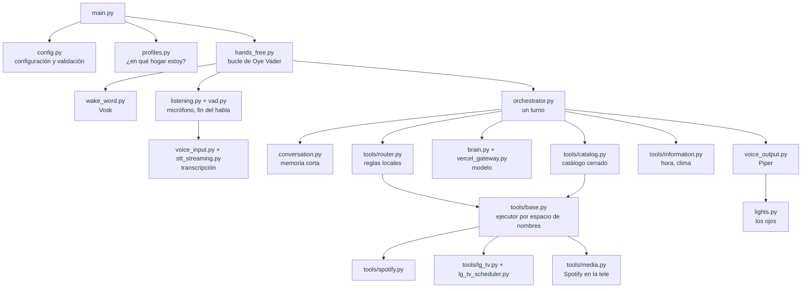

# Cómo funciona

[English](../how-it-works.md) · [Volver al README](../../README.es.md)

VaderMind es un programa Python sin servidor web ni app. Parte desde la
terminal (o desde systemd en la Pi), escucha, piensa con un modelo en la nube,
actúa con código local y habla con una voz local. Esta página sigue una frase
desde el micrófono hasta el parlante y explica dónde están los límites de
seguridad.

## Componentes

| Capa | Archivos principales | Tarea |
| --- | --- | --- |
| Entrada | `main.py`, `orchestrator.py` | Leer opciones, validar la configuración, armar las piezas, procesar cada turno |
| Oídos | `hands_free.py`, `wake_word.py`, `listening.py`, `vad.py`, `voice_input.py`, `stt_streaming.py` | Palabra de activación, grabación, fin del habla, transcripción |
| Cerebro | `brain.py`, `vercel_gateway.py`, `persona.py` | Nivel de modelo, prompt de personalidad, streaming, pedidos de herramientas |
| Manos | `tools/router.py`, `tools/catalog.py`, `tools/base.py` y los ejecutores | Reglas locales, validación y el único código que habla con Spotify, el TV o el servicio del clima |
| Boca y ojos | `response_text.py`, `voice_output.py`, `lights.py` | Limpiar el texto, sintetizar, reproducir, animar los LEDs |
| Fontanería | `config.py`, `profiles.py`, `network_wait.py`, `warmup.py`, `telemetry.py` | Configuración, hogares, orden de arranque, conexiones precalentadas, tiempos |

## Un turno, paso a paso

**1. Esperando "Oye Vader".** `wait_for_wake_word()` abre el micrófono y le pasa
cada cuadro de 32 ms a Vosk, un reconocedor pequeño de español que funciona sin
internet. Su gramática es cerrada: la frase de activación, unas frases chilenas
que suenan parecido y sirven de señuelo ("vas a ver", "oye", "vader" solo) y
"desconocido". Vosk pronuncia "Vader" a la española, así que también acepta la
variante "oye bei der" (como suena "Oye Veider"). Solo cuenta el resultado
final, y cada palabra necesita una confianza mínima: el resultado parcial, una
adivinanza temprana, despertaba a Vader con un "oye" suelto. **Ningún audio
sale del equipo hasta que se oye la frase.**

**2. Escuchando.** Los ojos pasan a "escuchando". `record_utterance()` lee
cuadros de 32 ms. El micrófono USB de la Pi solo graba a 44,1 o 48 kHz, así que
Vader graba a 48 kHz, convierte a 16 kHz y quita todo lo que está bajo ~90 Hz.
Silero VAD (ONNX, en un hilo) da la probabilidad de voz de cada cuadro; el
turno termina tras 800 ms de silencio, 15 s en total o 6 s sin voz. Se guardan
los 320 ms previos al inicio del habla, para no perder la primera sílaba.

**3. Transcribir antes de que termines.** Dos trucos esconden la espera:

- *Streaming.* Al empezar a escuchar se abre un WebSocket a la transcripción en
  streaming de Vercel (`grok-stt`) y cada cuadro se envía mientras hablas. En
  la primera pausa el texto llega en unos 0,3 s, casi siempre antes de que
  terminen los 800 ms de silencio.
- *Especulación.* Cada pausa de 192 ms también envía lo captado hasta ahí a una
  transcripción normal, en un hilo. Si sigues hablando, se descarta; si el
  silencio se mantiene, se usa y no se repite nada.

Si el streaming falla, entra el camino REST (`gpt-4o-transcribe` con un
contexto de chilenismos y el nombre de Vader, y luego `grok-stt` de respaldo).
Se descartan las transcripciones en otro idioma, las vacías y las
alucinaciones típicas.

**4. Guardas antes del modelo.** `process_turn()` limpia el texto y lo agrega a
la memoria corta. Las compras, reservas, inicios de sesión, formularios y
publicaciones se rechazan localmente. Las preguntas de actualidad fuera de la
hora y el clima (noticias, precios, deportes) se responden como "no
disponible" sin llamar a nadie.

**5. Primero las reglas locales.** `parse_tool_call()` reconoce órdenes claras:
*"pausa"*, *"siguiente canción"*, *"sube el volumen de la tele"*, *"modo
chileno"*, *"silencio"*. Esas van directo al ejecutor sin pasar por el modelo,
y Vader responde en unos 1,7 s.

**6. El modelo.** Todo lo demás va a Gemini 3.5 Flash-Lite a través de Vercel
AI Gateway, con el prompt de personalidad, los últimos 8 mensajes y un
catálogo de intenciones que puede pedir. Solo las solicitudes con marcas
explícitas de complejidad ("paso a paso") usan Gemini 3.7 Flash, que también es
el respaldo si falla el modelo rápido. Cada solicitud le pide al gateway no
usar los datos para entrenar.

**7. El catálogo cerrado.** Si el modelo pide una herramienta, `catalog.py`
traduce la intención a un nombre interno y valida cada argumento: tipos,
listas cerradas, rangos numéricos y largos máximos. Se rechaza más de una
herramienta por turno. Después el orquestador comprueba que la integración
esté configurada y se la pasa a su ejecutor. Una respuesta de texto del modelo
nunca ejecuta nada.

**8. Hablar.** `response_text.py` quita markdown, listas y acotaciones
("*respira pesadamente*"), porque Vader es solo una voz. En las acciones de
Spotify, Vader dice una confirmación breve *antes* de actuar y, mientras
tanto, un hilo adelanta la parte de solo lectura (búsqueda, lista de
dispositivos). Si sale bien no dice nada más; si falla, siempre lo dice.

**9. La voz.** Un proceso Piper queda abierto con el modelo cargado. La
respuesta se divide en oraciones (y las oraciones largas en las comas); un
hilo las sintetiza una tras otra y la primera suena apenas está lista. En la
Pi, `aplay` reproduce cada WAV por el jack de 3,5 mm mientras el anillo de los
ojos sigue la envolvente de volumen de ese WAV. El micrófono está cerrado
mientras Vader habla, así que nunca se escucha a sí mismo.

**10. Seguimiento.** Después de la respuesta, Vader escucha 10 segundos más sin
la palabra de activación. Si nadie habla, vuelve a esperar y los ojos se
atenúan.

## Las herramientas y sus límites

**Spotify** usa la Web API con el flujo Authorization Code y un callback
local; el token queda en un archivo local. Las mutaciones nunca se repiten
solas tras un fallo ambiguo, y los cambios de playlists piden confirmación. Un
`403` del reproductor se informa como restricción del dispositivo, nunca como
éxito.

**El TV LG webOS** se controla por la red local con
[aiowebostv](https://github.com/home-assistant-libs/aiowebostv). Una conexión
queda abierta en un event loop de fondo: abrirla cuesta unos 4 s y una orden
por ella unos 0,05 s. Cada "Oye Vader" la precalienta en un hilo, así una
conexión caída se reabre mientras hablas y no cuando llega la orden. Apps,
entradas y canales se eligen solo de lo que publica el propio TV; el modelo
nunca puede enviar un endpoint SSAP, una URL o un botón arbitrario. La
navegación se limita a Inicio, Atrás, flechas y OK. Encender usa Wake-on-LAN
solo hacia la MAC configurada, y solo informa éxito cuando webOS vuelve a
responder. Los temporizadores se limitan a apagar y a mensajes, entre 1 minuto
y 24 horas, y sobreviven a los reinicios.

**Spotify en la tele** (`media.py`) es el único flujo que cruza integraciones:
despierta el TV si hace falta, abre Spotify, espera un dispositivo Spotify
Connect controlable, transfiere la reproducción y comprueba que la música
realmente suena.

**Hora y clima.** La hora usa el reloj del equipo, o la zona horaria de una
ciudad que el usuario nombró de verdad (buscada con el geocodificador de
Open-Meteo). El clima hace solicitudes HTTPS GET solo a los hosts de
geocodificación y pronóstico de Open-Meteo, sin seguir redirecciones. La URL
nunca sale del texto del modelo.

**Apagar.** *"Vader, apágate"* es una orden local fija con confirmación
hablada. Nunca llega al modelo, y solo funciona con `VADER_ALLOW_SHUTDOWN=true`.

## Personalidades

`persona.py` guarda los dos modos, cada uno con su carácter, su forma de
responder y unos pocos ejemplos de tono originales. Ambos responden en una o
dos oraciones por defecto, y hasta cinco solo si se pide una explicación o
pasos. *Canon* es frío, solemne y exacto. *Chileno* es Vader después de años en
Chile: el humor primero, chilenismos y garabatos permitidos. Un banco fijo de
15 preguntas (`scripts/evaluate_persona.py`) mide cada cambio de prompt con
números antes de escucharlo.

## Hogares y perfiles

El casco viaja entre dos hogares. Todo lo que es de un hogar (cuenta de
Spotify, TV, temporizadores, personalidad) vive en `profiles/<nombre>/`, fuera
de Git. Al partir, `profiles.py` elige el perfil desde `--perfil` o
`VADER_PROFILE`; si no, según el nombre de la red Wi-Fi (`nmcli` en Linux,
`netsh` en Windows); y si no, el último usado. En un arranque en frío el Wi-Fi
todavía no está, así que cuando llega la red Vader revisa de nuevo y, si es
otro hogar, se reinicia una vez en el mismo proceso.

## Orden de arranque en la Pi

`deploy/vadermind.service` lanza `main.py --manos-libres --esperar-red`. Le pide
la red a systemd pero no la espera: Vader carga Vosk, Silero y Piper mientras
el Wi-Fi conecta, y recién ahí espera `network-online.target` y precalienta
las conexiones del modelo, la transcripción y el TV. Los ojos quedan oscuros
hasta que Vader está realmente listo, así nunca se pierde un "Oye Vader".

## Datos locales

| Archivo | Qué es | ¿En Git? |
| --- | --- | --- |
| `.env` | Claves y configuración del equipo | No (`.env.example` documenta cada opción) |
| `.spotify_token.json`, `.lg_tv_client_key`, `.lg_tv_schedules.json` | Sesión de Spotify, emparejamiento del TV, temporizadores | No |
| `profiles/<nombre>/` | Una carpeta por hogar con sus propias copias de lo anterior | No |
| `models/` | Voz Piper, Silero VAD, Vosk | No |
| Conversación | Los últimos mensajes | Solo en memoria; desaparece cuando Vader se detiene |

## Errores

Si falta configuración, el arranque se detiene con un mensaje claro. Los
fallos del modelo, los errores de Spotify y del TV y los problemas de audio se
informan por separado, y en manos libres se dicen en voz alta. Algunos errores
de red todavía no se atrapan; ver "Limitaciones conocidas" en el
[README](../../README.es.md#limitaciones-conocidas).
