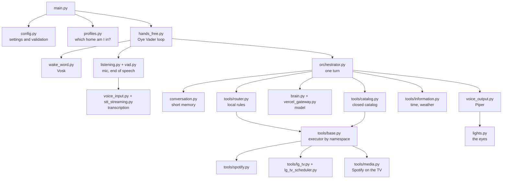

# How it works

[Español](es/como-funciona.md) · [Back to the README](../README.md)

VaderMind is a Python program with no web server and no app. It starts from the
terminal (or from systemd on the Pi), listens, thinks with a cloud model,
acts through local code and speaks with a local voice. This page follows one
sentence from the microphone to the speaker, and explains where the safety
boundaries are.

## Components

| Layer | Main files | Job |
| --- | --- | --- |
| Entry | `main.py`, `orchestrator.py` | Parse options, validate settings, build the pieces, run each turn |
| Ears | `hands_free.py`, `wake_word.py`, `listening.py`, `vad.py`, `voice_input.py`, `stt_streaming.py` | Wake word, recording, end of speech, transcription |
| Brain | `brain.py`, `vercel_gateway.py`, `persona.py` | Model tier, personality prompt, streaming, tool requests |
| Hands | `tools/router.py`, `tools/catalog.py`, `tools/base.py` and the executors | Local rules, validation, and the only code that talks to Spotify, the TV or the weather service |
| Mouth and eyes | `response_text.py`, `voice_output.py`, `lights.py` | Clean the text, synthesize, play, animate the LEDs |
| Plumbing | `config.py`, `profiles.py`, `network_wait.py`, `warmup.py`, `telemetry.py` | Settings, homes, boot order, pre-warmed connections, timings |

## One turn, step by step

**1. Waiting for "Oye Vader".** `wait_for_wake_word()` opens the microphone and
feeds every 32 ms frame to Vosk, a small offline Spanish recognizer. Its
grammar is closed: the wake phrase, a few Chilean decoys that sound alike
("vas a ver", "oye", "vader" alone) and "unknown". Vosk pronounces "Vader" the
Spanish way, so the variant "oye bei der" (what "Oye Veider" sounds like) is
also accepted. Only the final result counts, and each word needs a minimum
confidence: the partial result, an early guess, used to wake Vader on a lone
"oye". **No audio leaves the device until the phrase is heard.**

**2. Listening.** The eyes switch to "listening". `record_utterance()` reads
32 ms frames. The USB microphone of the Pi only records at 44.1 or 48 kHz, so
Vader records at 48 kHz, resamples to 16 kHz and removes everything below
~90 Hz. Silero VAD (ONNX, in a thread) gives the probability of speech per
frame; the turn ends after 800 ms of silence, 15 s in total or 6 s without any
voice. The 320 ms before speech started are kept, so the first syllable is not
lost.

**3. Transcription, before you finish.** Two tricks hide the wait:

- *Streaming.* When listening starts, a WebSocket opens to Vercel's streaming
  transcription (`grok-stt`) and every frame is sent while you speak. On the
  first pause the text arrives in about 0.3 s, usually before the 800 ms of
  silence are over.
- *Speculation.* Every 192 ms pause also sends what was captured so far to a
  regular transcription request in a thread. If you keep talking, it is
  discarded; if the silence holds, it is used and nothing is repeated.

If streaming fails, the REST path takes over (`gpt-4o-transcribe` with a
context of Chilean slang and Vader's name, then `grok-stt` as a fallback).
Transcripts in another language, empty ones and typical hallucinations are
discarded.

**4. Guards before the model.** `process_turn()` cleans the text and adds it to
the short memory. Purchases, bookings, logins, forms and posts are refused
locally. Questions about current events beyond time and weather (news,
prices, sports) are answered as "not available" without calling anyone.

**5. Local rules first.** `parse_tool_call()` recognizes clear orders:
*"pausa"*, *"siguiente canción"*, *"sube el volumen de la tele"*, *"modo
chileno"*, *"silencio"*. Those go straight to the executor without the model,
and Vader answers in about 1.7 s.

**6. The model.** Everything else goes to Gemini 3.5 Flash-Lite through Vercel
AI Gateway, with the personality prompt, the last 8 messages and a catalog of
intents it may request. Only requests with explicit markers of complexity
("paso a paso") use Gemini 3.7 Flash, which is also the fallback if the fast
model fails. Every request asks the gateway not to use the data for training.

**7. The closed catalog.** If the model asks for a tool, `catalog.py` maps the
intent to an internal name and validates every argument: types, closed lists,
numeric ranges and maximum lengths. More than one tool call in a turn is
rejected. The orchestrator then checks that the integration is configured and
hands it to its executor. A text answer from the model never runs anything.

**8. Speaking.** `response_text.py` removes markdown, lists and stage
directions ("*breathes heavily*"), because Vader is only a voice. For Spotify
actions Vader speaks a short confirmation *before* acting, and meanwhile a
thread prefetches the read-only part (search, device list). On success it says
nothing more; on failure it always says so.

**9. The voice.** A Piper process stays open with the model loaded. The answer
is split into sentences (and long sentences at commas); a thread synthesizes
them one after another and the first one plays as soon as it is ready. On the
Pi, `aplay` plays each WAV through the 3.5 mm jack while the eye ring follows
the volume envelope of that WAV. The microphone is closed while Vader speaks,
so it never hears itself.

**10. Follow-up.** After the answer, Vader listens for 10 more seconds without
the wake word. If nobody speaks, it goes back to waiting and the eyes dim.

## The tools and their limits

**Spotify** uses the Web API with an Authorization Code flow and a local
callback; the token stays in a local file. Mutations are never retried
automatically after an ambiguous failure, and playlist changes ask for
confirmation. A `403` from the player is reported as a device restriction,
never as success.

**LG webOS TV** is controlled on the local network with
[aiowebostv](https://github.com/home-assistant-libs/aiowebostv). One connection
stays open in a background event loop: opening it costs about 4 s, an order
over it about 0.05 s. Every "Oye Vader" re-warms it in a thread, so a dropped
connection is reopened while you speak, not when the order arrives. Apps,
inputs and channels are chosen only from what the TV itself publishes; the
model can never send an SSAP endpoint, a URL or an arbitrary button.
Navigation is limited to Home, Back, arrows and OK. Power-on uses
Wake-on-LAN to the configured MAC only, and reports success only when webOS
answers again. Timers are limited to power-off and messages, between 1 minute
and 24 hours, and survive restarts.

**Spotify on the TV** (`media.py`) is the only flow that crosses
integrations: it wakes the TV if needed, opens Spotify, waits for a
controllable Spotify Connect device, transfers playback and checks that the
music is really playing.

**Time and weather.** Time uses the device clock, or the time zone of a city
the user actually named (looked up with Open-Meteo's geocoder). Weather makes
HTTPS GET requests only to Open-Meteo's geocoding and forecast hosts, without
following redirects. The URL never comes from the model's text.

**Shutting down.** *"Vader, apágate"* is a fixed local order with a spoken
confirmation. It never reaches the model, and it only works with
`VADER_ALLOW_SHUTDOWN=true`.

## Personalities

`persona.py` holds the two modes, each with its character, answer form and a
few original tone examples. Both answer in one or two sentences by default and
up to five only when asked for an explanation or steps. *Canon* is cold,
solemn and exact. *Chileno* is Vader after years in Chile: humor first,
Chilean slang and swearing allowed. A fixed bank of 15 questions
(`scripts/evaluate_persona.py`) measures every prompt change with numbers
before anyone listens to it.

## Homes and profiles

The helmet travels between two homes. Everything that belongs to a home
(Spotify account, TV, timers, personality) lives in `profiles/<name>/`, outside
Git. At startup `profiles.py` picks the profile from `--perfil` or
`VADER_PROFILE`, otherwise from the Wi-Fi network name (`nmcli` on Linux,
`netsh` on Windows), otherwise the last one used. On a cold boot the Wi-Fi is
not up yet, so after the network arrives Vader checks again and, if it is
another home, restarts itself once in the same process.

## Boot order on the Pi

`deploy/vadermind.service` starts `main.py --manos-libres --esperar-red`. It
asks systemd for the network but does not wait for it: Vader loads Vosk,
Silero and Piper while the Wi-Fi connects, and only then waits for
`network-online.target` and pre-warms the model, transcription and TV
connections. The eyes stay dark until Vader is really ready, so an "Oye Vader"
is never lost.

## Local data

| File | What | In Git? |
| --- | --- | --- |
| `.env` | Keys and settings of the device | No (`.env.example` documents every setting) |
| `.spotify_token.json`, `.lg_tv_client_key`, `.lg_tv_schedules.json` | Spotify login, TV pairing, timers | No |
| `profiles/<name>/` | One folder per home with its own copies of the above | No |
| `models/` | Piper voice, Silero VAD, Vosk | No |
| Conversation | The last messages | Only in memory, gone when Vader stops |

## Errors

Missing settings stop the start with a clear message. Model failures,
Spotify and TV errors and audio problems are reported separately, and in
hands-free mode they are said out loud. Some network errors are not caught
yet; see "Known limitations" in the [README](../README.md#known-limitations).
